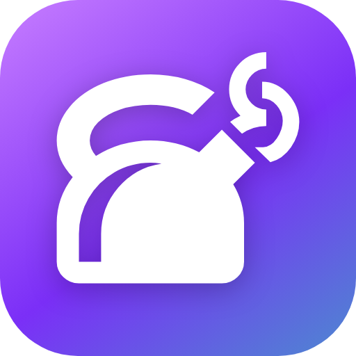
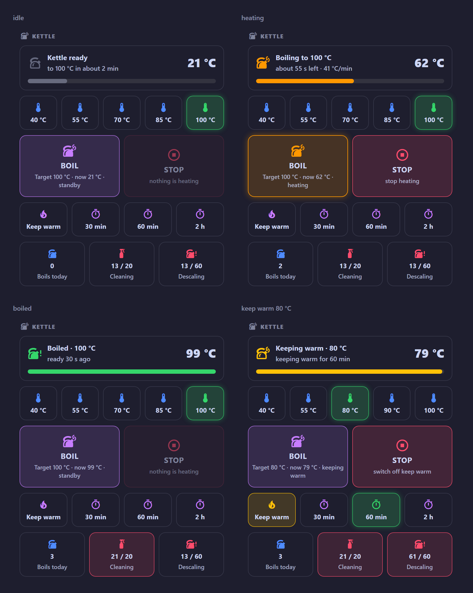

# Smart Kettle

**English** · [Polski](README.pl.md)

[](https://github.com/jotuera/smart-kettle-ha/actions/workflows/ci.yml)
[](https://hacs.xyz)
[](https://www.home-assistant.io)
[](i18n)
[](LICENSE)
[](https://buymeacoffee.com/jotuera)

**A Home Assistant integration and Lovelace card for Tuya / Smart Life Wi-Fi kettles – SETTI+ KT950W, Götze & Jensen KT975K, AENO, Lidl SilverCrest and others.** In Home
Assistant a smart kettle is a switch, a number and a temperature sensor. This card turns them into a kettle: how far it
is to the target and how long it will take, how much water you poured in, one-tap temperatures **and drinks** (green
tea 80 °C with a steeping countdown, baby formula boiled and held at 45 °C…), Boil / Stop, keep warm, *ready at 6:30*,
today's energy and cost, and boil counters that tell you when to clean and descale. One JavaScript file, no other
custom cards, no YAML templates.

> Built on the author's **Götze & Jensen KT975K** (Tuya core integration), from a button-card dashboard used since
> September 2026. The **SETTI+ KT950W** has the same entities in HA. Other kettles: [docs/models.md](docs/models.md).
>
> **Status: beta (0.3.0).** The card runs on the author's kettle; its logic is covered by tests with a mocked HA.
> **New in 0.3.0: a Home Assistant integration** that installs the card by itself and replaces the helpers and
> blueprints – install in three clicks.



<sub>Ready (ETA to the target), boiling (progress from the start temperature, ETA from the live rate, amount of water),
boiled, keeping warm, the Drinks tab with a green tea steeping and *ready at 6:30*, the compact card. Counters turn
red when cleaning / descaling is due.</sub>

## What it does

| Part | What you get |
|---|---|
| **Top tile** | *Kettle ready – to 100 °C in about 2 min* → *Boiling to 100 °C – about 55 s left · 41 °C/min · about 0.7 l* with a progress bar → *Boiled · 100 °C – ready 30 s ago* → *Keeping warm · 80 °C*. With a drink: *Green tea · 80 °C – steeping, 1:25 left*. Also *unavailable*, *no water* and *little water?*. Tap = history. |
| **°C tab** | One tap sets the target temperature; the current one glows. **Hold = set and boil.** From the kettle's profile, clamped to its range. |
| **Drinks tab** | 12 drinks with their temperature, keep warm and steeping time – tap to set, **hold to set and boil** (table below). Your own drinks too. |
| **Modes tab** | When the kettle has a mode select (tea modes in tuya-local, *Work mode* in core Tuya). |
| **Boil / Stop** | Boil starts the kettle (*Target 100 °C · now 21 °C · standby*). Stop switches off heating **and** keep warm. |
| **Keep warm** | Switch and time chips (30 min, 1 h, 2 h …), limited to the kettle's maximum. |
| **Ready at** | *Ready at 06:30 – start at about 06:28* – on / off and the time (with the blueprint). |
| **Counters** | Boils today, since cleaning (every 20), since descaling (every 60, or by your water hardness) – **hold** to reset. |
| **Energy line** | *today 0.13 kWh · 0.14 zł · last 08:01 (1.5 min)* – from the recorder, estimated from the power or read from a plug meter. |

- **Finds the kettle by itself** – core Tuya entities by their translation keys, so it does not matter what the
  entities are called or which language HA uses (`_temperatura`, `_temperature`, `_temperatur` …). tuya-local
  kettles by their `water_heater`. Every entity can be set by hand (LocalTuya).
- **Progress without helpers** – the water temperature at the moment you pressed Boil is read from the recorder.
- **Learns your kettle** – after each boil the card stores the measured heating rate (°C/min) in the browser and
  uses it for the ETA before heating starts.
- **How much water** – from the heating rate and the kettle's power: *m = P · η / (c · ΔT/Δt)*. Shown while heating
  and as a *little water?* warning when the kettle heats suspiciously fast.
- **Compact card** (`compact: true`) – one row with the progress and a Boil / Stop button, e.g. for an overview.
- **°F kettles**, **9 languages** (English, Polski, Deutsch, Čeština, Slovenčina, Français, Italiano, Español,
  Nederlands – the language of your HA profile), visual editor, theme colours you can override.

## Drinks

| Drink | Temperature | Keep warm | Steeping |
|---|---|---|---|
| `green_tea` Green tea | 80 °C | – | 2.5 min |
| `white_tea` White tea | 75 °C | – | 4 min |
| `matcha` Matcha | 75 °C | – | – |
| `oolong` Oolong | 90 °C | – | 4 min |
| `coffee` Coffee (drip, French press) | 95 °C | – | 4 min |
| `yerba` Yerba mate | 75 °C | 30 min | – |
| `black_tea` Black tea | 100 °C | – | 4 min |
| `herbal` Herbal tea | 100 °C | – | 5 min |
| `formula` Baby formula | 100 °C → **45 °C** | 120 min | – |
| `honey` Honey water | 40 °C | 60 min | – |
| `oatmeal` Porridge / noodles | 100 °C | – | – |
| `drink_water` Warm water | 55 °C | 60 min | – |

Default tiles: green tea, coffee, black tea, yerba mate, baby formula, warm water – pick others in the editor. A
temperature the kettle cannot set is moved to the nearest one it can (coffee 95 °C → 90 °C on a 5-step kettle).
**Baby formula** is boiled first (WHO advice for powdered formula) and then cooled down to 45 °C and kept warm: the
card does the second step when it is open; with the helper and the blueprint below it happens without a browser.

Own drinks:

```yaml
drinks:
  - green_tea
  - coffee
  - { name: Pu-erh, icon: mdi:tea, temp: 95, steep: 3 }
  - { name: Bottle warm-up, icon: mdi:baby-bottle, temp: 40, keep: 60 }
  - { name: Mother's tea, temp: 100, then: 70, keep: 30 }   # boil, then hold 70 °C
```

## Installation – three clicks

1. **HACS** → ⋮ → *Custom repositories* → `https://github.com/jotuera/smart-kettle-ha`, type **Integration** →
   download *Smart Kettle* → restart Home Assistant.
2. Settings → Devices & services → **Add integration** → *Smart Kettle*. Your kettle is found by itself – pick the
   profile and confirm.
3. Add the card – *Smart Kettle Card* in the card picker, or `type: custom:smart-kettle-card`.

That is all: **no Lovelace resource, no helpers, no blueprints, no YAML.** The integration serves the card, adds its
entities to the kettle's own device and does in Home Assistant what a browser cannot: counts the boils, learns the
heating rate, sums today's energy, runs the drinks' second stage, notifies when the water is ready and when the
steeping is over, and switches the kettle on for *ready at 6:30*.

| Entity (on the kettle's device) | |
|---|---|
| *Boils today*, *Boils since cleaning / descaling* + buttons *Cleaned*, *Descaled*, binary sensors *Cleaning / Descaling due* | counters |
| *Heating rate* (learned, °C/min), *Water in the last boil* (l), *Energy today* (kWh, Energy dashboard ready), *Cost today*, *Last boil* | measured |
| *Drink* (select: 12 drinks – sets temperature and keep warm, steeping and formula stage in HA) | drinks |
| *Ready at* (time), *Ready at – on* (switch), *"Ready at" start* | schedule |

**Options** (the integration's *Configure*): profile, power, price per kWh or a price entity, cleaning / descaling
interval, boil threshold, the *ready at* temperature, **notifications** – pick mobile apps (or a script, which gets
`title` and `message`), notify when the water is ready, when the steeping is over.

The integration works on top of the kettle's own entities (Tuya, tuya-local, LocalTuya) – it needs no cloud account
and no local key. Several kettles: add the integration once per kettle.

**Card only (without the integration):** HACS can install one type per repository, so copy `dist/smart-kettle-card.js`
to `/config/www/` and add `/local/smart-kettle-card.js?v=0.3.0` as a *JavaScript module* resource. The card then
counts with the optional helpers and blueprints below and keeps what it learns in the browser.

## Configuration

```yaml
type: custom:smart-kettle-card
title: Kettle                        # "" hides the header
profile: setti_kt950w                # see docs/models.md – presets, keep-warm times and power of your kettle
presets: [40, 55, 70, 85, 100]       # optional – overrides the profile
keep_warm_times: [30, 60, 120]       # optional – minutes
drinks: [green_tea, coffee, black_tea, yerba, formula, drink_water]
tab: drinks                          # first tab: temps | drinks | modes (the last one used is remembered)
compact: false
device: 0123456789abcdef0123456789abcdef   # optional – when you have more than one kettle
entities:                            # optional – only what was not found
  start: switch.kettle_start
  target: number.kettle_temperature
  current: sensor.kettle_current_temperature
  status: sensor.kettle_status
  keep_warm: switch.kettle_heat_preservation
  keep_warm_time: number.kettle_heat_preservation_time
  # mode: select.kettle_work_mode        # tea modes / work mode
  # water_heater: water_heater.kettle    # tuya-local instead of start / target / current
  # drink / ready_at / ready_at_on       # helpers – default: those of packages/smart_kettle.yaml
counters:                            # optional – default: the helpers of packages/smart_kettle.yaml
  today: counter.kettle_boils_today
  cleaning: counter.kettle_boils_since_cleaning
  descaling: counter.kettle_boils_since_descaling
cleaning_every: 20
descaling_every: 60                  # or water_hardness: soft (120) | medium (60) | hard (30)
power: 2200                          # W – amount of water and energy (default: the profile's)
price: 1.10                          # per kWh, in the currency of HA – or price_entity: sensor.electricity_price
energy_entity: sensor.kettle_plug_energy   # optional kWh meter of the kettle's plug instead of the estimate
rate: 40                             # optional °C/min – fixed instead of learned
show: { header: true, presets: true, controls: true, keep_warm: true, ready_at: true, counters: true, stats: true }
```

Colours follow the theme; override them with card-mod or a theme: `--kettle-blue`, `--kettle-purple`,
`--kettle-green`, `--kettle-red`, `--kettle-yellow`, `--kettle-peach`, `--kettle-teal`, `--kettle-radius`.

## Helpers and blueprints (card only – the integration does all of this)

Copy [`packages/smart_kettle.yaml`](packages/smart_kettle.yaml) to `/config/packages/`
(`homeassistant: packages: !include_dir_named packages` in `configuration.yaml`) and restart. The card finds the
helpers by their ids. Import the blueprints (Settings → Automations → Blueprints → *Import*, paste the file's GitHub
URL) and create an automation from each one you want:

| Blueprint | What it does | Uses |
|---|---|---|
| [`smart_kettle_boil_counter.yaml`](blueprints/automation/jotuera/smart_kettle_boil_counter.yaml) | counts a boil when the water stays above 90 °C for 20 s (at most once per 10 min); *boils today* resets at midnight | the three counters |
| [`smart_kettle_ready.yaml`](blueprints/automation/jotuera/smart_kettle_ready.yaml) | when the water is ready runs your actions (notification, TTS, light); for a drink with a steeping time waits and runs your *steeped* actions (`{{ drink_name }}`, `{{ steep }}`); for baby formula sets 45 °C and keep warm | `input_text.kettle_drink` |
| [`smart_kettle_ready_at.yaml`](blueprints/automation/jotuera/smart_kettle_ready_at.yaml) | *ready at 6:30* – switches the kettle on early enough (from the water temperature and the heating rate), once a day | `input_datetime.kettle_ready_at`, `input_boolean.kettle_ready_at` |

After cleaning or descaling **hold** the counter on the card to reset it. Your own counters work too – set them under
`counters:`.

## Kettles

| Kettle | Integration | Profile | Status |
|---|---|---|---|
| **Götze & Jensen KT975K** | Tuya | `gotze_jensen_kt975k` | **tested** |
| **SETTI+ KT950W** | Tuya, tuya-local | `setti_kt950w` | same entities as the KT975K |
| AENO EK7S, Fiesta DK1G, SilverCrest (Lidl Home), Webber WK115, Nedis SmartLife, Weekett, Korex, Blow, Goldair… | Tuya, tuya-local | own profiles / `auto` | untested |

The full list with temperatures, keep-warm ranges, the entities and the status values: **[docs/models.md](docs/models.md)**.
Kettles with tea *modes* instead of a temperature (Svensson, ProfiCook / Koenic, AENO EK1S) get the *Modes* tab.

## Good to know

- **The kettle is in the cloud.** The Tuya integration gets the kettle's changes pushed (MQTT) – usually within a
  second or two. If the temperature only updates every minute, try tuya-local (local, no cloud).
- **Started from HA, the kettle sometimes beeps twice and stops** (reported for the KT950W) – that is the kettle's
  own protection (lifted from the base, no water); press Boil again.
- **ETA before heating** uses the learned rate (or the profile's 40 °C/min). Half a kettle heats about twice as fast –
  the ETA while heating comes from the live rate, and so does the amount of water (± 20 %: the efficiency and the
  kettle's own mass are estimated).
- **Steeping and the formula's second step in the card** need the card open in a browser; the blueprint
  `smart_kettle_ready.yaml` does them in Home Assistant itself.
- **Energy** is estimated from the heating time and the power (no plug meter needed); with `energy_entity` the real
  reading of the plug is used.

## Development

```bash
python3 tools/build_i18n.py          # after editing i18n/*.json – inlines the texts into the card
python3 tools/build_integration.py   # after editing the card – copies it into the integration, builds its translations
python3 tools/build_i18n.py --check && python3 tools/build_integration.py --check   # CI
node tests/test_card.js              # card logic with a mocked Home Assistant
python3 -m http.server 8781          # then http://localhost:8781/tests/preview.html?lang=pl – all states
```

A new language: copy `i18n/en.json`, translate, add the code to `LANGS` in `tools/build_i18n.py`, run the build.

## License

[PolyForm Noncommercial 1.0.0](LICENSE) – free for personal and other noncommercial use; commercial use needs a
license from the author. Acknowledgements: [NOTICE](NOTICE).

If the card saves you a walk to the kitchen – [buy me a coffee](https://buymeacoffee.com/jotuera) ☕
