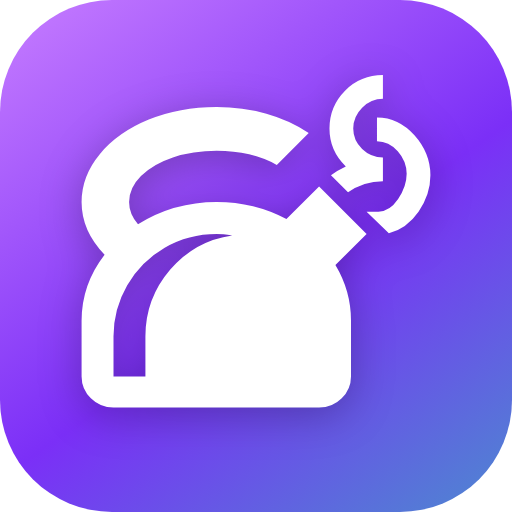
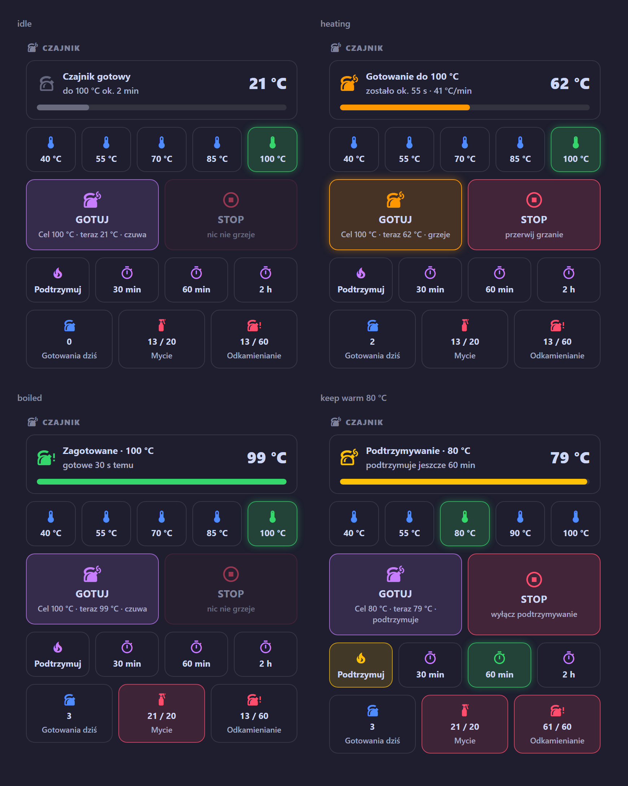

# Smart Kettle

[English](README.md) · **Polski**

[](https://github.com/jotuera/smart-kettle-ha/actions/workflows/ci.yml)
[](https://hacs.xyz)
[](https://www.home-assistant.io)
[](i18n)
[](LICENSE)
[](https://buymeacoffee.com/jotuera)

**Integracja Home Assistant i karta Lovelace do czajników Wi-Fi Tuya / Smart Life – SETTI+ KT950W, Götze & Jensen KT975K, AENO, Lidl SilverCrest i innych.** W Home
Assistant inteligentny czajnik to przełącznik, liczba i czujnik temperatury. Ta karta robi z nich czajnik: ile
zostało do celu i ile to potrwa, ile wody nalałeś, temperatury **i napoje** jednym dotknięciem (zielona herbata
80 °C z odliczaniem parzenia, mleko modyfikowane zagotowane i trzymane w 45 °C…), Gotuj / Stop, podtrzymywanie,
*gotowe na 6:30*, dzisiejsza energia i koszt oraz liczniki gotowań, które przypominają o myciu i odkamienianiu. Jeden
plik JavaScript, bez innych kart custom, bez szablonów YAML.

> Zbudowana na czajniku autora **Götze & Jensen KT975K** (integracja Tuya w HA), z karty button-card używanej od
> września 2026. **SETTI+ KT950W** ma w HA te same encje. Inne czajniki: [docs/models.md](docs/models.md).
>
> **Status: beta (0.3.0).** Karta działa na czajniku autora; jej logika pokryta testami z atrapą HA.
> **Nowe w 0.3.0: integracja Home Assistant**, która sama instaluje kartę i zastępuje pomocniki oraz blueprinty –
> instalacja w trzech kliknięciach.



<sub>Gotowy (czas dojścia do celu), gotowanie (postęp od temperatury startowej, czas z bieżącego tempa, ilość wody),
zagotowane, podtrzymywanie, zakładka Napoje z parzeniem zielonej herbaty i *gotowe na 6:30*, karta kompaktowa.
Liczniki robią się czerwone, gdy czas na mycie / odkamienianie.</sub>

## Co robi

| Część | Co dostajesz |
|---|---|
| **Górny kafel** | *Czajnik gotowy – do 100 °C ok. 2 min* → *Gotowanie do 100 °C – zostało ok. 55 s · 41 °C/min · ok. 0,7 l* z paskiem → *Zagotowane · 100 °C – gotowe 30 s temu* → *Podtrzymywanie · 80 °C*. Z napojem: *Zielona herbata · 80 °C – parzenie, jeszcze 1:25*. Także *niedostępny*, *brak wody* i *mało wody?*. Dotknięcie = historia. |
| **Zakładka °C** | Dotknięcie ustawia temperaturę; bieżąca świeci. **Przytrzymanie = ustaw i gotuj.** Z profilu czajnika, przycięte do jego zakresu. |
| **Zakładka Napoje** | 12 napojów z temperaturą, podtrzymaniem i czasem parzenia – dotknij, aby ustawić, **przytrzymaj, aby od razu gotować** (tabela niżej). Także własne napoje. |
| **Zakładka Tryby** | Gdy czajnik ma wybór trybu (tryby herbat w tuya-local, *Work mode* w Tuya). |
| **Gotuj / Stop** | Gotuj włącza czajnik (*Cel 100 °C · teraz 21 °C · czuwa*). Stop wyłącza grzanie **i** podtrzymywanie. |
| **Podtrzymuj** | Przełącznik i czasy (30 min, 1 h, 2 h …), ograniczone do maksimum czajnika. |
| **Gotowe na** | *Gotowe na 06:30 – start ok. 06:28* – wł. / wył. i godzina (z blueprintem). |
| **Liczniki** | Gotowania dziś, od mycia (co 20), od odkamieniania (co 60 albo wg twardości wody) – **przytrzymaj**, aby wyzerować. |
| **Linia energii** | *dziś 0,13 kWh · 0,14 zł · ostatnio 08:01 (1,5 min)* – z historii, szacowana z mocy albo z licznika gniazdka. |

- **Sama znajduje czajnik** – encje integracji Tuya po kluczach tłumaczeń, więc nie ma znaczenia, jak się nazywają
  ani w jakim języku jest HA (`_temperatura`, `_temperature`, `_temperatur` …). Czajniki z tuya-local po ich
  `water_heater`. Każdą encję można wskazać ręcznie (LocalTuya).
- **Postęp bez pomocników** – temperatura wody w chwili naciśnięcia Gotuj jest odczytywana z historii (recorder).
- **Uczy się Twojego czajnika** – po każdym gotowaniu zapamiętuje w przeglądarce tempo grzania (°C/min) i używa go do
  szacowania czasu przed startem.
- **Ile wody** – z tempa grzania i mocy czajnika: *m = P · η / (c · ΔT/Δt)*. Widać w trakcie grzania, a gdy czajnik
  grzeje podejrzanie szybko – ostrzeżenie *mało wody?*.
- **Karta kompaktowa** (`compact: true`) – jeden wiersz z postępem i przyciskiem Gotuj / Stop, np. do przeglądu domu.
- **Czajniki °F**, **9 języków** (English, Polski, Deutsch, Čeština, Slovenčina, Français, Italiano, Español,
  Nederlands – język Twojego profilu HA), edytor wizualny, kolory motywu do nadpisania.

## Napoje

| Napój | Temperatura | Podtrzymanie | Parzenie |
|---|---|---|---|
| `green_tea` Zielona herbata | 80 °C | – | 2,5 min |
| `white_tea` Biała herbata | 75 °C | – | 4 min |
| `matcha` Matcha | 75 °C | – | – |
| `oolong` Oolong | 90 °C | – | 4 min |
| `coffee` Kawa (drip, french press) | 95 °C | – | 4 min |
| `yerba` Yerba mate | 75 °C | 30 min | – |
| `black_tea` Czarna herbata | 100 °C | – | 4 min |
| `herbal` Zioła | 100 °C | – | 5 min |
| `formula` Mleko modyfikowane | 100 °C → **45 °C** | 120 min | – |
| `honey` Woda z miodem | 40 °C | 60 min | – |
| `oatmeal` Owsianka / zupka | 100 °C | – | – |
| `drink_water` Ciepła woda | 55 °C | 60 min | – |

Domyślne kafle: zielona herbata, kawa, czarna herbata, yerba mate, mleko modyfikowane, ciepła woda – inne wybierzesz w
edytorze. Temperatura, której czajnik nie ustawi, jest zamieniana na najbliższą możliwą (kawa 95 °C → 90 °C przy
czajniku ze skokiem 5). **Mleko modyfikowane** jest najpierw zagotowywane (zalecenie WHO dla mleka w proszku), potem
studzone do 45 °C i podtrzymywane: drugi krok robi karta, gdy jest otwarta; z pomocnikiem i blueprintem niżej dzieje się
bez przeglądarki.

Własne napoje:

```yaml
drinks:
  - green_tea
  - coffee
  - { name: Pu-erh, icon: mdi:tea, temp: 95, steep: 3 }
  - { name: Podgrzanie butelki, icon: mdi:baby-bottle, temp: 40, keep: 60 }
  - { name: Herbatka dla mamy, temp: 100, then: 70, keep: 30 }   # zagotuj, potem trzymaj 70 °C
```

## Instalacja – trzy kliknięcia

1. **HACS** → ⋮ → *Custom repositories* → `https://github.com/jotuera/smart-kettle-ha`, typ **Integration** →
   pobierz *Smart Kettle* → zrestartuj Home Assistant.
2. Ustawienia → Urządzenia i usługi → **Dodaj integrację** → *Smart Kettle*. Czajnik zostanie znaleziony sam – wybierz
   profil i zatwierdź.
3. Dodaj kartę – *Smart Kettle Card* w wyborze kart albo `type: custom:smart-kettle-card`.

To wszystko: **bez zasobów Lovelace, pomocników, blueprintów i YAML.** Integracja sama serwuje kartę, dodaje swoje
encje do urządzenia czajnika i robi w Home Assistant to, czego nie zrobi przeglądarka: liczy gotowania, uczy się tempa
grzania, sumuje dzisiejszą energię, robi drugi etap napojów, powiadamia, gdy woda gotowa i gdy minie czas parzenia,
oraz włącza czajnik na *gotowe na 6:30*.

| Encja (na urządzeniu czajnika) | |
|---|---|
| *Gotowania dziś*, *Gotowania od mycia / odkamieniania* + przyciski *Umyty*, *Odkamieniony*, czujniki *Czas na mycie / odkamienianie* | liczniki |
| *Tempo grzania* (wyuczone, °C/min), *Woda w ostatnim gotowaniu* (l), *Energia dziś* (kWh, gotowa do panelu Energia), *Koszt dziś*, *Ostatnie gotowanie* | pomiary |
| *Napój* (select: 12 napojów – ustawia temperaturę i podtrzymanie, parzenie i 2. etap mleka w HA) | napoje |
| *Gotowe na* (czas), *Gotowe na – wł.* (przełącznik), *Start „gotowe na”* | harmonogram |

**Opcje** (*Konfiguruj* w integracji): profil, moc, cena za kWh lub encja ceny, co ile mycie / odkamienianie, próg
gotowania, temperatura *gotowe na*, **powiadomienia** – wybierz aplikacje mobilne (albo skrypt, który dostaje `title`
i `message`), powiadomienie gdy woda gotowa i po czasie parzenia.

Integracja działa „nad” encjami samego czajnika (Tuya, tuya-local, LocalTuya) – nie potrzebuje konta w chmurze ani
klucza lokalnego. Kilka czajników: dodaj integrację raz dla każdego.

**Sama karta (bez integracji):** HACS instaluje jeden typ na repozytorium, więc skopiuj `dist/smart-kettle-card.js` do
`/config/www/` i dodaj zasób `/local/smart-kettle-card.js?v=0.3.0` jako *Moduł JavaScript*. Karta liczy wtedy z
opcjonalnymi pomocnikami i blueprintami poniżej, a to, czego się uczy, trzyma w przeglądarce.

## Konfiguracja

```yaml
type: custom:smart-kettle-card
title: Czajnik                       # "" ukrywa nagłówek
profile: setti_kt950w                # zob. docs/models.md – temperatury, czasy podtrzymania i moc Twojego czajnika
presets: [40, 55, 70, 85, 100]       # opcjonalnie – zastępuje profil
keep_warm_times: [30, 60, 120]       # opcjonalnie – minuty
drinks: [green_tea, coffee, black_tea, yerba, formula, drink_water]
tab: drinks                          # pierwsza zakładka: temps | drinks | modes (ostatnio używana jest zapamiętywana)
compact: false
device: 0123456789abcdef0123456789abcdef   # opcjonalnie – gdy masz więcej niż jeden czajnik
entities:                            # opcjonalnie – tylko to, czego nie znalazła
  start: switch.czajnik_start
  target: number.czajnik_temperatura
  current: sensor.czajnik_current_temperature
  status: sensor.czajnik_status
  keep_warm: switch.czajnik_heat_preservation
  keep_warm_time: number.czajnik_heat_preservation_time
  # mode: select.czajnik_work_mode       # tryby herbat / tryb pracy
  # water_heater: water_heater.czajnik   # tuya-local zamiast start / target / current
  # drink / ready_at / ready_at_on       # pomocniki – domyślnie te z packages/smart_kettle.yaml
counters:                            # opcjonalnie – domyślnie pomocniki z packages/smart_kettle.yaml
  today: counter.kettle_boils_today
  cleaning: counter.kettle_boils_since_cleaning
  descaling: counter.kettle_boils_since_descaling
cleaning_every: 20
descaling_every: 60                  # albo water_hardness: soft (120) | medium (60) | hard (30)
power: 2200                          # W – ilość wody i energia (domyślnie z profilu)
price: 1.10                          # za kWh, w walucie HA – albo price_entity: sensor.cena_pradu
energy_entity: sensor.gniazdko_czajnika_energia   # opcjonalnie licznik kWh gniazdka zamiast szacunku
rate: 40                             # opcjonalnie °C/min – stałe zamiast wyuczonego
show: { header: true, presets: true, controls: true, keep_warm: true, ready_at: true, counters: true, stats: true }
```

Kolory idą za motywem; nadpiszesz je card-modem albo w motywie: `--kettle-blue`, `--kettle-purple`, `--kettle-green`,
`--kettle-red`, `--kettle-yellow`, `--kettle-peach`, `--kettle-teal`, `--kettle-radius`.

## Pomocniki i blueprinty (tylko dla samej karty – integracja robi to wszystko)

Skopiuj [`packages/smart_kettle.yaml`](packages/smart_kettle.yaml) do `/config/packages/` (w `configuration.yaml`
`homeassistant: packages: !include_dir_named packages`) i zrestartuj HA. Karta sama znajdzie pomocniki po ich id.
Zaimportuj blueprinty (Ustawienia → Automatyzacje → Blueprinty → *Importuj*, wklej adres pliku na GitHubie) i utwórz
automatyzację z każdego, którego chcesz:

| Blueprint | Co robi | Używa |
|---|---|---|
| [`smart_kettle_boil_counter.yaml`](blueprints/automation/jotuera/smart_kettle_boil_counter.yaml) | liczy gotowanie, gdy woda trzyma powyżej 90 °C przez 20 s (najwyżej raz na 10 min); *gotowania dziś* zerują się o północy | trzy liczniki |
| [`smart_kettle_ready.yaml`](blueprints/automation/jotuera/smart_kettle_ready.yaml) | gdy woda gotowa – Twoje akcje (powiadomienie, TTS, światło); dla napoju z parzeniem czeka i uruchamia akcje *po parzeniu* (`{{ drink_name }}`, `{{ steep }}`); dla mleka ustawia 45 °C i podtrzymanie | `input_text.kettle_drink` |
| [`smart_kettle_ready_at.yaml`](blueprints/automation/jotuera/smart_kettle_ready_at.yaml) | *gotowe na 6:30* – włącza czajnik odpowiednio wcześniej (z temperatury wody i tempa grzania), raz dziennie | `input_datetime.kettle_ready_at`, `input_boolean.kettle_ready_at` |

Po myciu lub odkamienianiu **przytrzymaj** licznik na karcie, aby go wyzerować. Własne liczniki też działają – wskaż je
w `counters:`.

## Czajniki

| Czajnik | Integracja | Profil | Status |
|---|---|---|---|
| **Götze & Jensen KT975K** | Tuya | `gotze_jensen_kt975k` | **przetestowany** |
| **SETTI+ KT950W** | Tuya, tuya-local | `setti_kt950w` | te same encje co KT975K |
| AENO EK7S, Fiesta DK1G, SilverCrest (Lidl Home), Webber WK115, Nedis SmartLife, Weekett, Korex, Blow, Goldair… | Tuya, tuya-local | własne profile / `auto` | nieprzetestowane |

Pełna lista z temperaturami, zakresami podtrzymania, encjami i wartościami statusu: **[docs/models.md](docs/models.md)**.
Czajniki z *trybami* herbat zamiast temperatury (Svensson, ProfiCook / Koenic, AENO EK1S) dostają zakładkę *Tryby*.

## Dobrze wiedzieć

- **Czajnik jest w chmurze.** Integracja Tuya dostaje zmiany czajnika wypychane (MQTT) – zwykle w sekundę, dwie.
  Jeśli temperatura odświeża się co minutę, spróbuj tuya-local (lokalnie, bez chmury).
- **Włączony z HA czajnik czasem pika dwa razy i się wyłącza** (zgłaszane dla KT950W) – to zabezpieczenie samego
  czajnika (zdjęty z podstawy, brak wody); naciśnij Gotuj jeszcze raz.
- **Czas przed startem** liczony jest z wyuczonego tempa (albo 40 °C/min z profilu). Pół czajnika grzeje się mniej
  więcej dwa razy szybciej – w trakcie grzania czas i ilość wody liczone są z bieżącego tempa (± 20 %: sprawność
  i masa samego czajnika są szacowane).
- **Parzenie i drugi krok mleka w karcie** wymagają otwartej karty w przeglądarce; blueprint `smart_kettle_ready.yaml`
  robi to w samym Home Assistant.
- **Energia** jest szacowana z czasu grzania i mocy (licznik gniazdka niepotrzebny); z `energy_entity` brany jest
  prawdziwy odczyt gniazdka.

## Rozwój

```bash
python3 tools/build_i18n.py          # po zmianie i18n/*.json – wkleja teksty do karty
python3 tools/build_integration.py   # po zmianie karty – kopiuje ją do integracji, buduje jej tłumaczenia
python3 tools/build_i18n.py --check && python3 tools/build_integration.py --check   # CI
node tests/test_card.js              # logika karty z atrapą Home Assistant
python3 -m http.server 8781          # potem http://localhost:8781/tests/preview.html?lang=pl – wszystkie stany
```

Nowy język: skopiuj `i18n/en.json`, przetłumacz, dopisz kod do `LANGS` w `tools/build_i18n.py`, uruchom build.

## Licencja

[PolyForm Noncommercial 1.0.0](LICENSE) – za darmo do użytku prywatnego i innego niekomercyjnego; użycie komercyjne
wymaga licencji od autora. Podziękowania: [NOTICE](NOTICE).

Jeśli karta oszczędza Ci spaceru do kuchni – [postaw mi kawę](https://buymeacoffee.com/jotuera) ☕
